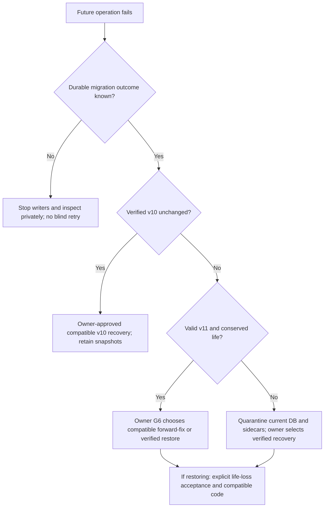

# Maple Room R1b — Cutover and Compatibility Plan

**STEP162 — R1B-01 REVIEW / ACCEPTED FOR INTEGRATION REVIEW / MERGE PENDING.** Owner accepts STEP161 local work for final publication review, subject to fresh validation, and authorizes documentation corrections, reviewed commit, normal push, PR and CI inspection for01 only. Separate owner merge approval is required. R1B-02–12 remain11TODO;0/12DONE=0%. D01–D06 OPEN; no projection strategy or future implementation approved. No runtime/test changes, schema11 registration/activation, DB migration/data access, production/paolo-core, deployment, default switch, repin, B14 orR4. Earlier dated authorization/evidence below is historical. [R1B-01 inventory](maple-room-r1b-01-contract-inventory.md).

**STEP161 — R1B-01 REVIEW / pending owner acceptance.** Verified PR22 merge baseline `edb6b128e41590d2822bdbe41c16e68d3f634206`. Bounded G2 authorizes only R1B-01 inventory, source inspection, existing-contract verification and test-case planning. No runtime or test implementation. R1B-02–12 remain 11 TODO; completion is 0/12 DONE = 0%. D01–D06 remain OPEN; no projection strategy selected. No current publication P, stage, commit, push, PR, merge, real-data access/copy/migration, production/paolo-core, deployment, default switch, repin, B14 or R4. Planning PR22 is merged; earlier dated status blocks below are historical. [R1B-01 inventory](maple-room-r1b-01-contract-inventory.md).

**STEP159,2026-10-12 — PLANNING REVIEW / OWNER ACCEPTED / MERGE PENDING.** G1 is accepted for planning-document integration only: final review, documentation corrections, commit, normal push, PR and CI inspection are authorized. Merge requires separate owner authorization. G2 implementation and G3–G7 operational/default-switch authority are NOT granted; future implementation publication P is also NOT granted. All12implementation workstreams remain TODO (0/12 DONE, including after a future planning-only merge). D01–D06 remain OPEN; no projection strategy is approved. Historical STEP158 records below describe the planning stage.

**STEP158,2026-10-12 — planning only / REVIEW.** No cutover, state change, implementation, snapshot/copy, schema activation or production action. [Master Plan](maple-room-r1b-plan.md), [migration safety](maple-room-r1b-migration-safety.md), [risk/gates](maple-room-r1b-risk-gates.md).

## 1. Current and future authority

Current source: [MapleState](../../backend/src/maplegotchi/core/state.py), [LifeRuntime](../../backend/src/maplegotchi/runtime/life.py), [repositories](../../backend/src/maplegotchi/storage/repositories.py), [MapleService](../../backend/src/maplegotchi/runtime/service.py), [legacy room](../../backend/src/maplegotchi/core/room.py). Persisted v10 life/action/needs/RNG/goal/reaction/task and legacy routes are authoritative. Isolated world engine, fixture renderer and test-only v11 candidate do not drive live state.

Future R1b target under [ADR0037](../adr/0037-world-persistence-v11-migration-and-legacy-projection.md): one immutable validated active layout and grid tile/edge/route/time/point state in backend; room derived from region; capability resolution and deterministic core rules reused. Existing legacy fields become a pure projection of that same committed world truth. No second writer, mirrored independent simulation or frontend behavior engine. Canonical44×26 final house8regions/5open/3closed/7corridors/431walkable instantiated once directly from accepted data; no temporary single-room world. Keep accepted250ms/step/penalty1 and all Oracle/catalog/slot constraints.

## 2. Compatibility decisions and boundaries

[Pure projection](../../backend/src/maplegotchi/core/world/legacy_projection.py) and [R09 STEP120](maple-room-r1a-09-legacy-projection.md#step-120--owner-acceptance-and-r1b-pre-cutover-integration-gate) intentionally reject40/400collapsed-anchor pairs plus ambiguous transient mid-edge origins. Owner deferred old renderer/anchor/walker expansion. D01 is **OPEN by explicit owner direction after STEP158: keep OPEN and resolve before affected implementation.** No strategy was approved. No backend prevention strategy or Legacy compatibility change is approved, selected or implemented. No further strategy choice is requested in this planning continuation. Must prove every runtime-reachable state and restart/reroute case safe; merely catching errors, inventing graph loops, substituting Hall or erasing time is forbidden. R1a rejection tests remain valid unless owner accepts a precise contract amendment.

Migration transition is distinct: existing in-flight legacy route maps to a zero-length grid destination plan at original arrival, no fabricated events (Final Spec sectionR). Normal runtime travel must advance four-direction steps without teleport; preserve departures/arrivals, pending starts, activity minimum durations, needs/RNG counters, reaction until, goal/task/suspension and action identity. Runtime integration must test before-departure/mid-edge/arrival/postarrival and restart/downtime boundaries. Unsupported mapping fails migration preflight, rather than silently interrupting history. Owner edit layout_changed/replanning semantics belong to R4, not a new migration event.

Production Legacy remains the default after R1b grid cutover. Greet/Pet, vitals/journal/panels, stale/disconnected indicators and accepted compatibility endpoints remain functional and truthful. [main.tsx](../../frontend/src/main.tsx), [coexistence](../../frontend/src/dev/RoomSwitcher.tsx) and [gate](../../frontend/src/world-room/gate.ts) currently permit New only in development fixtures. Backend grid activation does not grant production New renderer enablement. Existing query/direct-route production bypass guards and Legacy Pixi lifecycle stay; any later live preview enablement needs separate explicit scope and cannot imply default switch. B14/G7 remains separate.

## 3. Live API/SSE contract work — proposed, not implemented

[World DTO](../../backend/src/maplegotchi/api/world_models.py) has development_fixture/synthetic literals and fixture hash identity; [normal router](../../backend/src/maplegotchi/api/world_routes.py) returns503 until live activation. D03 must define a distinct truthful live source/status, persisted layout/world revision relationship, time/position/route consistency, catalog identity and reconnect behavior. Do not simply return a fixture object from normal production app or reinterpret its content hash as a committed database revision. Read-only live GETs derive one consistent committed snapshot and do not mutate life.

Preserve `/api/room`, legacy snapshot and existing SSE fields/timing/meaning through projection. Additive world SSE remains a proposed decision only if demonstrated need exists; define event revision ordering, replay/gap/resync and stale state with contract/route-table/OpenAPI/generated TypeScript tests. No change to exact Origin/CSP, trusted sources, Greet/Pet mutation boundary or gateway identity. No R4 owner auth/editor endpoint is added. Fixture-only app must stay explicitly labeled/non-live and unable to open production data. UI must never present fixture/simulation as real Maple, including error/reconnect paths.

## 4. Future cutover sequence and checkpoints

Every row below is **FUTURE / REQUIRES OWNER AUTHORIZATION**; not executable authority from STEP158. Phase labels identify when production state would change.

| Step | Gate / checkpoint | Planned action and evidence | State effect / stop |
|---|---|---|---|
| C01 Prepare and freeze | G2/P;01–09 accepted | Review exact release, schema/mapping/compatibility/digest, synthetic and CI evidence; real-copy rehearsal under G3; complete runbook | Local/rehearsal only; no production mutation |
| C02 **FUTURE / REQUIRES OWNER AUTHORIZATION** Readiness | G4 | Current owner-held copy + automatic-copy readiness, independent restore proof, source freshness, exact release/version, operator/window/data-loss acceptance | FUTURE host/data operations need explicit permission; missing proof stops |
| C03 **FUTURE / REQUIRES OWNER AUTHORIZATION** Quiesce and snapshot | G5 exact approved operation | Stop writers/accepted service sequence, verify approved source identity/schema, stage/verify retained owner-held snapshot; prove matching source before startup | First production operational change is quiescence; new snapshot is approved data-copy operation, not migration |
| C04 **FUTURE / REQUIRES OWNER AUTHORIZATION** Activate reviewed release | G5 | Use reviewed activation after owner snapshot gate; compatible code/expected schema and artifact identity verified | Code/service pointers may change; script does not itself migrate or restart; flag alone not proof |
| C05 **FUTURE / REQUIRES OWNER AUTHORIZATION** Single migration/start | G5 | Approved service start invokes verified automatic copy and atomic10→11; verification then durable commit | First world/schema data conversion; backend grid becomes authoritative at this cutover, no mixed temporary world |
| C06 **FUTURE / REQUIRES OWNER AUTHORIZATION** Startup invariant load | G5/G6 scope defined | Future production repository/core loads valid11; expose consistent truthful compatibility/live reads | No fabricated state; refusal/ambiguity stops acceptance and further writes per approved recovery protocol |
| C07 **FUTURE / REQUIRES OWNER AUTHORIZATION** Post-cutover verification | G6 scoped operations | Check health/boundaries/identity/history/counters/house/grid/Legacy/API/activities/reactions/restart as authorized | A successful HTTP health response alone is insufficient; actual outcomes required |
| C08 **FUTURE / REQUIRES OWNER AUTHORIZATION** Accept or recover | G6 decision | Owner accepts R1b or explicitly chooses compatible forward-fix, verified restore or safe stop | No automatic repair/restore/retry; preserve evidence and known life-loss decision |
| C09 B14 handoff | Later G7 | Separate final-art/device/accessibility/parity/security/seven-day production soak/final owner review | No default switch or Legacy removal in R1b acceptance; one-full-release rollback retention after later switch |

G5 approval must name exact migration + state-cutover operation, not merely deployment. Snapshot/activation/start sequence and single-writer ownership are finalized/tested before readiness. Candidate changes after real-copy rehearsal require affected evidence repeated before G4. If outage or source changes invalidate the packet, re-enter readiness; do not widen approval by inference.

## 5. Observability and future post-cutover acceptance

Proposed operator evidence, reviewed in10/12: release SHA/schema/active revision and canonical hash; source identity fingerprint/conservation manifest; committed life revision and route/timing; startup/load success or structured failure; migration start/outcome and verified snapshot reference; projection refusal, recovery relocation/path failure, action-loop/decision failure, API/SSE disconnect/staleness and service loop error. Keep private data/seed/content out of public logs. Correlate committed revisions rather than combining reads from different transactions. Exact metric/log exposure is future design; no new endpoint/threshold is invented here.

Future verification covers exact source→target conservation, FK/integrity/core load, all open-room interactions, closed-room inaccessibility, grid/recovery correctness, pending/active/suspended activity continuity, Legacy point/pose/arrival/needs/reaction agreement, Greet/Pet unchanged, truthful live/fixture identity, no production New bypass, approved restart/catch-up and restore readiness. Unexpected failure/recovery, unknown schema/commit state, projection rejection reachable during normal life, fixture/live mismatch or missing snapshot makes acceptance stop. G6 records actual observations/limitations, not a claim inferred from CI or R1a synthetic success.

## 6. Recovery decision tree

Application/view rollback differs from state rollback: selecting Legacy does not undo grid/schema; swapping code to v10 against11 must refuse. No down-migration. Restore is owner-controlled verified data replacement with stopped service, quarantined DB/WAL/SHM, correct permissions, matching code and re-verification, with loss since snapshot accepted explicitly. See [migration safety section6](maple-room-r1b-migration-safety.md#6-recovery-code-rollback-versus-state-restore).

## 7. B14/R4 handoff

[ADR0040 section4](../adr/0040-room-view-transition-and-acceptance-gate.md#4-acceptance-gate-for-making-the-new-room-the-default-b14) requires10conditions, physical tablet/phone, final art, seven-day production soak, exact budgets/accessibility/security and final owner visual signoff. The old view/projection/front-back persist for at least one full release after a separately authorized default switch and are removed only later. [ADR0038](../adr/0038-owner-edit-mode-and-owner-authentication.md) owner Edit Mode, dedicated secret/session, identity-header spike, draft/save/revert and mutation validation are R4, not started, not required for B14 and not authorized by R1b. Room opening/representation/autonomous-placement work remains its own roadmap authorization.

## STEP158 continuation — D01 and implementation boundary

D01 stays OPEN: the known40collapsed-anchor walking pairs and ambiguous mid-edge projections remain evidence for a future owner decision. R1B-01 may inventory accepted contracts and dependencies with D01 OPEN; R1B-02/03 may follow under future boundedG2 using fixed migration mappings, isolated loaders and synthetic-only conversion tests. None of01–03 implements normal live projection or admits production data.

R1B-04/05 implementation is directly blocked by D01. R1B-06–12 are transitively blocked through integrated runtime/compatibility/CI/rehearsal readiness. Their full scope is not independently startable. Retain every future production gate/stop condition; local synthetic03 success cannot authorize a real-copy run, shipped registration, activation or cutover. All12workstreams remainTODO; no strategy or new architecture is selected.
