# Maple Room R1b — Master Plan and Readiness

**STEP162 — R1B-01 REVIEW / ACCEPTED FOR INTEGRATION REVIEW / MERGE PENDING.** Owner accepts STEP161 local work for final publication review, subject to fresh validation, and authorizes documentation corrections, reviewed commit, normal push, PR and CI inspection for01 only. Separate owner merge approval is required. R1B-02–12 remain11TODO;0/12DONE=0%. D01–D06 OPEN; no projection strategy or future implementation approved. No runtime/test changes, schema11 registration/activation, DB migration/data access, production/paolo-core, deployment, default switch, repin, B14 orR4. Earlier dated authorization/evidence below is historical. [R1B-01 inventory](maple-room-r1b-01-contract-inventory.md).

**STEP161 — R1B-01 REVIEW / pending owner acceptance.** Verified PR22 merge baseline `edb6b128e41590d2822bdbe41c16e68d3f634206`. Bounded G2 authorizes only R1B-01 inventory, source inspection, existing-contract verification and test-case planning. No runtime or test implementation. R1B-02–12 remain 11 TODO; completion is 0/12 DONE = 0%. D01–D06 remain OPEN; no projection strategy selected. No current publication P, stage, commit, push, PR, merge, real-data access/copy/migration, production/paolo-core, deployment, default switch, repin, B14 or R4. Planning PR22 is merged; earlier dated status blocks below are historical. [R1B-01 inventory](maple-room-r1b-01-contract-inventory.md).

**STEP159,2026-10-12 — PLANNING REVIEW / OWNER ACCEPTED / MERGE PENDING.** G1 is accepted for planning-document integration only: final review, documentation corrections, commit, normal push, PR and CI inspection are authorized. Merge requires separate owner authorization. G2 implementation and G3–G7 operational/default-switch authority are NOT granted; future implementation publication P is also NOT granted. All12implementation workstreams remain TODO (0/12 DONE, including after a future planning-only merge). D01–D06 remain OPEN; no projection strategy is approved. Historical STEP158 records below describe the planning stage.

**STEP158,2026-10-12 — PLANNING ONLY / REVIEW pending G1 owner acceptance.** All12 proposed implementation workstreams are TODO. No implementation, migration, real-data copy, production access, stage/commit/push/PR/merge/deploy authorized. Open decisions below prevent affected implementation/cutover, not completion of this planning packet. This is a proposal subordinate to accepted ADRs, not an amendment or execution runbook approval.

## 1. Scope and accepted baseline

R1a is **20 DONE /0 REVIEW /0 TODO =100% at repository level**, after owner acceptance in STEP156 and confirmed [PR21](https://github.com/payola469/Maplegotchi/pull/21) merge `3e89996216336f453b03939467e6a06cb33da3fb` at2026-10-12T11:21:59Z. This does not prove deployed state or authorize production. Clean Windows main was fetched/fast-forwarded only to that exact expected baseline. New worktree `C:/GitHub/Maplegotchi-worktrees/r1b-planning`, branch `codex/r1b-master-plan`; existing branches/worktrees retained.

R1b prepares and, only after separate gates, performs one final-house migration/state cutover: production-copy rehearsal; shipped v11; authoritative grid runtime with truthful Legacy projection; reviewed deterministic simulation change; production verification/restore readiness. The New Room default switch belongs to later B14. STEP158 executes none of these operations.

Accepted R1a [86-criterion report](maple-room-r1a-20-acceptance-gate.md), [plan section6](maple-room-r1a-plan.md#6-r1a--r1b-boundary), [checklist](maple-room-r1a-checklist.md), [PR21 CI/evidence](https://github.com/payola469/Maplegotchi/pull/21#issuecomment-6123181550): all eight jobs passed;Ubuntu3920/0skip,Windows3919/1POSIXskip; actual six-file atlas byte equality. Historical evidence, not fresh STEP158 regression/CI execution. Historical RTX budgets and physical-device limits remain attributed; R01 original-base CI/full raw baseline caveat remains accepted and unavailable.

## 2. Authority and source classification

Binding: [Final Spec](../architecture/maple-room-final-design-spec.md) sectionsK/N/R/S/T; [ADR0035](../adr/0035-world-model.md), [0036](../adr/0036-object-catalog-and-capabilities.md), [0037](../adr/0037-world-persistence-v11-migration-and-legacy-projection.md), [0038](../adr/0038-owner-edit-mode-and-owner-authentication.md), [0039](../adr/0039-storage-and-maple-slot-placement.md), [0040](../adr/0040-room-view-transition-and-acceptance-gate.md), [0041](../adr/0041-art-technical-contract.md); migration discipline [ADR0028 R1–R8](../adr/0028-activity-set-v2-events-and-schema-v4.md), [ADR0023](../adr/0023-release-and-runtime.md), [ADR0024](../adr/0024-maple-database-backup.md). Current context: [CLAUDE](../../CLAUDE.md), [architecture](../architecture.md), [deployment](../deployment.md), [frontend](../frontend.md).

Implemented source: [migration registry](../../backend/src/maplegotchi/storage/migrations.py), [database open/snapshot](../../backend/src/maplegotchi/storage/db.py), [runtime life](../../backend/src/maplegotchi/runtime/life.py), [service](../../backend/src/maplegotchi/runtime/service.py), [state](../../backend/src/maplegotchi/core/state.py), [test-only converter](../../backend/tests/rehearsal/v11.py), [world API DTOs](../../backend/src/maplegotchi/api/world_models.py), [unavailable production router](../../backend/src/maplegotchi/api/world_routes.py), [activation script](../../deploy/install/activate_release.sh), [snapshot helper](../../deploy/backup/maple_db_snapshot.py), [owner install/restore guide](../../deploy/install.md). Source inspection only; no database or host probe was run.

Accepted evidence: [R08 synthetic persistence](maple-room-r1a-08-persistence-v11.md), [R09 projection/STEP120 gate](maple-room-r1a-09-legacy-projection.md), [R10 API](maple-room-r1a-10-world-api-contracts.md), [R15 coexistence](maple-room-r1a-15-coexistence.md), [R17 simulation](maple-room-r1a-17-fixtures-simulation.md), [R18 CI](maple-room-r1a-18-ci-linux-reproducibility.md), [R19 performance](maple-room-r1a-19-performance-soak.md). Implemented behavior is distinct from binding design and these proposed R1b tasks. ADR0037 explicitly leaves exact schema/JSON shapes to the migration PR; R08 candidates do not freeze them. No material binding-source conflict was found; implementation gaps and earlier status statements are classified below rather than silently resolved.

## 3. Current versus target state

| Concern | Implemented accepted baseline | Proposed R1b target / prerequisite |
|---|---|---|
| Runtime/database | Registry1–10; MapleState uses RoomLocation/legacy points/routes; normal open migrates to latest shipped version | Reviewed v11 loaders/core runtime; grid sole authority, Legacy fields derived; registration and activation separately gated |
| Geometry | Approved initial_house/catalog data and pure engine, isolated from live life | Direct final44×26 house:8regions;5open (Central Hall,Bedroom,Living Room,Library,Work Studio);3closed (Creation Room,System Room,Future Space);7corridors/431walkable;34blocked/29references/26tiles/3reuses; no temporary layout |
| Persistence | R08 candidate under tests only, owned synthetic handles; wheel excludes it | Reviewed append-only revisions/active pointer/lookups/grid state/display hooks; no inventory or R4 editor |
| Migration | Synthetic converter guards external files and v11 startup is rejected by shipped code | Authorized real-copy adapter/rehearsal, then reviewed migration11 and one owner cutover; never weaken synthetic guard to admit live paths |
| Legacy projection | Pure development context;334 timed pairs/26zero-step/40collapsed-anchor failures plus ambiguous mid-edge rejection | D01 validated safe policy before live integration; no silent fake routes, Hall fallback or old walker enhancement |
| World API | Normal GETs503; successful DTO source literal development_fixture/status synthetic and content-hash fixture revision | D03 reviewed live DTO/source/revision contract and snapshot consistency; never relabel fixture DTO as live without change/tests |
| SSE | Legacy EventHub/messages; world SSE deferred | Demonstrated-need decision; preserve existing compatibility and exact Origin/CSP; no new owner mutation surface |
| Renderer | Production Legacy bootstrap; dev fixture-only New; query cannot bypass production | Legacy default remains; New production enabling is outside this plan's execution authority and needs separate approval |
| Simulation | Original30-day pin and separate R17 grid pin;250ms/step/penalty1 | Explicit integrated comparison and reviewed pin change in authorized R1b change; preserve both old histories |
| Backup/readiness | Repository tooling and historical owner restore report | Current source/copies/restore must actually be verified under G3/G4; history is not present backup proof |

## 4. Boundaries and safety rules

R1b migration acceptance is separate from B14 visual/default-switch acceptance and R4 owner editing/authentication. Keep Legacy renderer/anchors/walker intact unless an explicit D01 amendment is approved; retain projection/front-back while Legacy exists. B14 requires all10 ADR0040 section4 conditions, including seven consecutive production days, real devices, final art, accessibility/security, final owner visual signoff and rollback for at least one full release after switch. Removal is a later separate change. R4 secret/session/identity-header spike and mutations are not prerequisite R1b/B14 features and are not started. No placement autonomy or Workspace/S5 representations are added merely because persistence hooks exist.

## 5. Proposed workstreams

Stable IDs below were accepted for planning integration in STEP159, not derived mechanically from the seven scope paragraphs; no implementation authorization follows. Current [checklist](maple-room-r1b-checklist.md):01 REVIEW after bounded STEP161 inventory;02–12 TODO;0DONE. Workstream definitions below remain the accepted future requirements.

| ID | Objective / title | Dependencies | Execution classification | Required authorization |
|---|---|---|---|---|
| R1B-01 | Contract inventory and compatibility decisions | G1 / G2 | LOCAL / contracts only | G1 then explicit G2 for this local inventory only; D01 resolution is not required and is not implied. |
| R1B-02 | v11 persistence contract and isolated loaders | R1B-01 | LOCAL / production-affecting code design | G2; accepted R1B-01 inventory with D01 still OPEN is sufficient. D02 reviewed before dependent03/09 and rechecked at G4. |
| R1B-03 | Unshipped migration and failure-safe adapter | R1B-02 | LOCAL / production-affecting preparation | G2; G3 required before any real-copy input. |
| R1B-04 | Authoritative grid runtime and restart integration | R1B-01, R1B-02 | LOCAL / production-affecting runtime | G2; D01 resolved before dependent behavior changes. |
| R1B-05 | Live contracts and Legacy compatibility | R1B-01, R1B-04 | LOCAL / production-affecting read compatibility | G2; D01 and D03 accepted before changing contracts. |
| R1B-06 | Simulation comparison and digest review | R1B-04, R1B-05 | LOCAL / simulation and evidence | G2 plus specific digest approval D05 before updating pinned assertions. |
| R1B-07 | Cross-platform regression and release isolation | R1B-03, R1B-04, R1B-05, R1B-06 | LOCAL / CI and release verification | G2 and separately authorized commit/push/PR/CI (not granted by STEP158). |
| R1B-08 | Owner-copy rehearsal and restore proof | R1B-03, R1B-07 | REAL DATA / isolated, sensitive, no production writes | G3 specific host/data/path/privacy/retention approval; not implied by G2. |
| R1B-09 | Shipped v11 registration and release contract | R1B-07, R1B-08 | LOCAL RELEASE / production-affecting registration | G2 for local code; separate P publication/review/merge approval after G3 copy acceptance. G4/G5 still required for production. |
| R1B-10 | Production readiness and snapshot gate | R1B-08, R1B-09 | PRODUCTION-AFFECTING / FUTURE / REQUIRES OWNER AUTHORIZATION | G4; any actual host/snapshot inspection requires separate explicit scope. |
| R1B-11 | Single production migration and grid cutover | R1B-10 | PRODUCTION-CHANGING / FUTURE / REQUIRES OWNER AUTHORIZATION | G5 explicit production migration AND state-cutover authorization; recovery actions under G6. |
| R1B-12 | Post-cutover verification and acceptance | R1B-11 | PRODUCTION-AFFECTING / FUTURE / REQUIRES OWNER AUTHORIZATION | G6; any further production verification/restart/restore scope explicit. |

### R1B-01 — Contract inventory and compatibility decisions

- **Objective:** Inventory accepted cutover contracts, interface boundaries and unresolved decisions without selecting a projection strategy.
- **Scope:** Record all400 provider pairs,40 collapsed-anchor rejections and ambiguous mid-edge evidence; distinguish fixed migration mapping from normal runtime projection; document existing DTO/revision contracts, OPEN decisions and downstream gates. No D01 strategy selection or implementation.
- **Dependencies:** G1 plan acceptance and explicit bounded G2; no D01 resolution prerequisite.
- **Expected output:** Owner-reviewed contract inventory, decision register, boundary/test-case map and D01 dependency assessment; D01 remains OPEN.
- **Tests / evidence:** Source/reference and contract-inventory checks; trace all400pair categories and mid-edge rejection to accepted R09 evidence; validate mapping/authorization boundaries and planned acceptance cases without changing code or pins.
- **Completion criteria:** Inventory and dependency boundaries accepted with D01 explicitly OPEN; no fabricated route, strategy choice or altered contract; G1 accepted and bounded G2 authorization recorded.
- **Non-goals:** No projection implementation, Legacy enhancement, owner auth or production work.
- **Required owner authorization:** G1 then explicit G2 for this local inventory only; D01 resolution is not required and is not implied.
- **Classification:** LOCAL / contracts only
- **Blocking decisions:** No D01 prerequisite for this inventory. G1/G2 still required; D01/D03 remain OPEN and no strategy is selected.

### R1B-02 — v11 persistence contract and isolated loaders

- **Objective:** Freeze reviewed v11 shapes and reconstruction invariants without registering production migration.
- **Scope:** Use ADR0037 append-only revision/active pointer/lookups/display hooks; inventory every v10 field/history/trigger/index/sequence; define new-birth versus existing-life behavior and exact loader/version policy.
- **Dependencies:** R1B-01
- **Expected output:** Reviewed schema/mapping specification and isolated repository/loader candidate after G2; ADR status amendments only if separately accepted.
- **Tests / evidence:** R08 synthetic tests; shipped v10/v11-too-new guards; round-trip core invariants; field-by-field conservation and all point mappings.
- **Completion criteria:** Migration PR contract review resolves proposed table/JSON/cap choices; one canonical world truth and complete conservation inventory.
- **Non-goals:** No owner Edit Mode, inventory subsystem, real copy or shipped registration.
- **Required owner authorization:** G2; accepted R1B-01 inventory with D01 still OPEN is sufficient. D02 reviewed before dependent03/09 and rechecked at G4.
- **Classification:** LOCAL / production-affecting code design
- **Blocking decisions:** Not blocked by D01. Requires accepted01 inventory and G2; resolve/freeze D02 within02 before dependent conversion/loader behavior is implemented. No live projection or startup registration.

### R1B-03 — Unshipped migration and failure-safe adapter

- **Objective:** Build a forward-only isolated candidate for later rehearsals.
- **Scope:** Promote reviewed logic into an explicit unshipped adapter; retain R08 synthetic factory refusal of arbitrary paths; two-copy gate, one transaction, capture/verify and exact final house conversion; scope trusted real-copy adapter separately.
- **Dependencies:** R1B-02
- **Expected output:** Unshipped candidate and synthetic failure evidence; no normal startup import/registration.
- **Tests / evidence:** Snapshot, partial DDL, conversion, FK, state, pre-commit failures; restart/commit ambiguity, disk-full/permission/source-change cases; retained backup opens in old code.
- **Completion criteria:** Old v10 unchanged on definite pre-commit failure; post-commit uncertainty refused pending inspection; source identity/history/sequence preserved; normal registry stays10.
- **Non-goals:** No automatic restore, reverse migration, real data or deployment.
- **Required owner authorization:** G2; G3 required before any real-copy input.
- **Classification:** LOCAL / production-affecting preparation
- **Blocking decisions:** Not blocked by D01 within the isolated synthetic-only scope. Requires02/D02 acceptance and G2; registry stays10, arbitrary real-copy input remains refused, no live runtime/projection adapter.

### R1B-04 — Authoritative grid runtime and restart integration

- **Objective:** Integrate pure R1a world engine into the life/runtime path as the sole future world authority.
- **Scope:** Persist/reload grid tile/edge/route, active revision and point refs; adapt heartbeat/Director capability decisions, needs/action/goal/task/reaction continuity and admission/write transactions; migrate directly to full house.
- **Dependencies:** R1B-01, R1B-02
- **Expected output:** Local synthetic runtime integration with gated startup; v10 compatibility lane retained until reviewed promotion.
- **Tests / evidence:** Runtime/storage suites; seeded decisions; all8 activities; 431-cell reachability/recovery; pending/in-flight/arrived routes, suspended actions, restart/downtime and no fabricated events.
- **Completion criteria:** No divergent legacy state or duplicate engine; deterministic timing250/1; closed rooms inaccessible; expected interruptions and committed revisions specified.
- **Non-goals:** No new autonomy, R4 placement/editor, production activation or default switch.
- **Required owner authorization:** G2; D01 resolved before dependent behavior changes.
- **Classification:** LOCAL / production-affecting runtime
- **Blocking decisions:** DIRECT D01 BLOCK: do not begin this workstream implementation while D01 is OPEN. Also requires02/D02 and G2; isolated persistence03 does not remove this gate.

### R1B-05 — Live contracts and Legacy compatibility

- **Objective:** Emit truthful compatibility fields from authoritative grid state without activating New Room in production.
- **Scope:** Implement approved R09 strategy, preserve Legacy snapshot/room/panels/Greet-Pet semantics; define live World DTO identity/revision/source distinct from development_fixture; justify any additive world SSE and reconnect policy.
- **Dependencies:** R1B-01, R1B-04
- **Expected output:** Reviewed local API/serializer/contract updates and compatibility proof; production New renderer remains disabled.
- **Tests / evidence:** API/SSE/security route-table/export tests; exhaustive400 pairs and transient origins; out-of-order/stale/reconnect; no fixture/live confusion; browser default/bundle/CSP/focus/cleanup.
- **Completion criteria:** Legacy remains functioning/default; departure/arrival/poses truthful; no invented snapshots/anchors; accepted DTO generation updated deliberately.
- **Non-goals:** No owner mutation endpoints, R4 auth, CSP/Origin relaxation, live New renderer enablement or B14.
- **Required owner authorization:** G2; D01 and D03 accepted before changing contracts.
- **Classification:** LOCAL / production-affecting read compatibility
- **Blocking decisions:** DIRECT D01 BLOCK: no strategy/compatibility implementation while D01 is OPEN. Also requires04, accepted D03 live DTO/SSE contract and G2.

### R1B-06 — Simulation comparison and digest review

- **Objective:** Prove integrated behavior and explain the deliberate R1b digest change.
- **Scope:** Compare original30-day and R17 grid harness to integrated fake-clock/RNG runtime; retain old history and input corpus; document intended event/route differences and determinism on both OSs.
- **Dependencies:** R1B-04, R1B-05
- **Expected output:** Comparison report and proposed new digest; actual pin change only under explicit owner review in the authorized integration change.
- **Tests / evidence:** Three matching complete traces; original30-day counter/event explanations; restart/recovery and projection cases; never accept a hash merely because code produced it.
- **Completion criteria:** Owner reviews intended differences and explicitly approves digest update; no unexplained loops/teleport/counter/history drift.
- **Non-goals:** No new pin in STEP158; no threshold or timing changes for test convenience.
- **Required owner authorization:** G2 plus specific digest approval D05 before updating pinned assertions.
- **Classification:** LOCAL / simulation and evidence
- **Blocking decisions:** INDIRECT D01 BLOCK through04/05. Requires their acceptance; D05 explicit approval before digest updates, with all old pins/history preserved.

### R1B-07 — Cross-platform regression and release isolation

- **Objective:** Close integrated synthetic/CI coverage before owner-data rehearsal and promotion.
- **Scope:** Keep existing eight-job matrix and actual same-revision atlas comparisons; add authorized integration collectors for migration/runtime/restart/API/default/bundle/security as needed.
- **Dependencies:** R1B-03, R1B-04, R1B-05, R1B-06
- **Expected output:** All-required local/CI evidence on exact candidate revision; source/art/package isolation and fail-closed startup proof.
- **Tests / evidence:** Full backend/frontend/companions/static/actionlint/ShellCheck; source-art/LFS; all6 atlas files; R1a validators/property/camera/lighting/lifecycle/archive regressions.
- **Completion criteria:** Every mandatory job passes; skips attributed; exact tested revision/evidence recorded; fixture adapter cannot leak into release.
- **Non-goals:** No hosted GPU claims, production data in CI, budget weakening or deployment.
- **Required owner authorization:** G2 and separately authorized commit/push/PR/CI (not granted by STEP158).
- **Classification:** LOCAL / CI and release verification
- **Blocking decisions:** INDIRECT D01 BLOCK through04/05/06. Full integrated closure cannot start or finish from03-only proof. P approval required for any future publication/CI.

### R1B-08 — Owner-copy rehearsal and restore proof

- **Objective:** Validate the exact candidate against an explicitly owner-approved production snapshot copy.
- **Scope:** Owner takes approved copy; isolate immutable source and disposable working descendants; disable network/providers/timers; validate complete conservation and old-version restore on isolated host.
- **Dependencies:** R1B-03, R1B-07
- **Expected output:** Private rehearsal/restore evidence tied to source fingerprint, release SHA/schema contract; public redacted summary only.
- **Tests / evidence:** Source integrity/FKs/version/identity; conversion and reconstruction; controlled failures on disposable clones; restore old v10 life; host filesystem/permissions and WAL handling.
- **Completion criteria:** Owner accepts actual copy migration/restore results; no assumption from R08 synthetic or historical restore; any candidate change triggers affected rehearsal review.
- **Non-goals:** No live migration or access to production beyond separately approved owner copy workflow.
- **Required owner authorization:** G3 specific host/data/path/privacy/retention approval; not implied by G2.
- **Classification:** REAL DATA / isolated, sensitive, no production writes
- **Blocking decisions:** INDIRECT D01 BLOCK through07. Also requires G3 real-copy/privacy scope and accepted exact candidate; no real-data access from local authorization.

### R1B-09 — Shipped v11 registration and release contract

- **Objective:** Approve how v11 enters shipped ordered migrations without accidental activation.
- **Scope:** Freeze new migration11 only, never edit1–10; integrate reviewed capture/verify/loader, tests and deployment/restore docs; latest_version/startup/activation consequences reviewed together.
- **Dependencies:** R1B-07, R1B-08
- **Expected output:** Reviewable migration/release PR with exact SHA, schema inventory and R1–R8 rollback story; no activation.
- **Tests / evidence:** v10→11 exactly once, existing11 no conversion/new events, incompatible future schema refusal; cold new-dev birth; wheel includes intended code only; activation gate simulations.
- **Completion criteria:** Reviewed migration11/release integration is separately approved and merged after G3 evidence; production activation remains forbidden pending G4/G5.
- **Non-goals:** No production start/deploy merely because migration is registered or CI green.
- **Required owner authorization:** G2 for local code; separate P publication/review/merge approval after G3 copy acceptance. G4/G5 still required for production.
- **Classification:** LOCAL RELEASE / production-affecting registration
- **Blocking decisions:** INDIRECT D01 BLOCK through07/08. Also requires D02 contract, actual-copy acceptance and separate P approval; no startup registration from03-only success.

### R1B-10 — Production readiness and snapshot gate

- **Objective:** Establish current verified readiness for one production cutover.
- **Scope:** Bind exact release, expected current schema and owner-held plus automatic pre-migration copy policy; rehearse stop/quiesce, filesystem capacity, restore and evidence freshness; record downtime/data-loss acceptance.
- **Dependencies:** R1B-08, R1B-09
- **Expected output:** Owner-signed readiness packet, current snapshot/restore evidence and exact authorized runbook; fail-closed go/no-go.
- **Tests / evidence:** Approved real-copy replay, source freshness check, backup integrity/FK/core checks, boundary/health prerequisites and rollback dry run; no unsupported performance/RTO target.
- **Completion criteria:** G4 explicitly accepts all current evidence; no stale/missing backup; exact release and restart procedure known; G5 separate.
- **Non-goals:** No production action from readiness alone; no services or snapshot execution during STEP158.
- **Required owner authorization:** G4; any actual host/snapshot inspection requires separate explicit scope.
- **Classification:** PRODUCTION-AFFECTING / FUTURE / REQUIRES OWNER AUTHORIZATION
- **Blocking decisions:** INDIRECT D01 BLOCK through08/09; D04 current snapshot/retry proof and D06 window/loss decisions required for G4 readiness.

### R1B-11 — Single production migration and grid cutover

- **Objective:** Execute the owner-authorized single transition directly into final house and grid movement.
- **Scope:** Future owner-controlled quiescence/snapshot/activation/start; one atomic migration then invariant-load and grid authority; preserve Legacy default and all histories; classify any uncertain commit before retry.
- **Dependencies:** R1B-10
- **Expected output:** Exact operation transcript with private evidence, schema/release/fingerprints, transaction outcome and stop/recovery decision.
- **Tests / evidence:** Future live integrity/FK/identity/counters/history/world/Legacy checks; no ad-hoc SQL repair or auto rollback.
- **Completion criteria:** G5 authorizes exact operation; source verified; one migration per approved source lineage; no temporary single-room world; G6 determines acceptance/recovery.
- **Non-goals:** No B14/default switch, R4 auth, placeholder opening or unsupervised retry.
- **Required owner authorization:** G5 explicit production migration AND state-cutover authorization; recovery actions under G6.
- **Classification:** PRODUCTION-CHANGING / FUTURE / REQUIRES OWNER AUTHORIZATION
- **Blocking decisions:** INDIRECT D01 BLOCK through10. Requires resolved candidate decisions, signed G4 and exact G5 operation; no production cutover with OPEN projection behavior.

### R1B-12 — Post-cutover verification and acceptance

- **Objective:** Verify migrated live state and obtain explicit owner R1b acceptance or recovery decision.
- **Scope:** Future health/boundary/functional/restart/Legacy/API/grid checks and failure signals; record real observations, conservation and known limits; hand off B14 prerequisites separately.
- **Dependencies:** R1B-11
- **Expected output:** Owner-reviewed R1b acceptance report or precise failure/recovery report; retained restore path and artifacts.
- **Tests / evidence:** Future live/restart checks with snapshot/state revision correlation, all8 activities and closed-room/recovery correctness; expected versus unexpected events; reviewed isolation and compatibility.
- **Completion criteria:** G6 owner accepts evidence and future merge/completion bookkeeping; failed verification stops acceptance and invokes approved forward-fix/restore decision.
- **Non-goals:** No seven-day B14 soak/default switch claim from a short post-cutover check.
- **Required owner authorization:** G6; any further production verification/restart/restore scope explicit.
- **Classification:** PRODUCTION-AFFECTING / FUTURE / REQUIRES OWNER AUTHORIZATION
- **Blocking decisions:** INDIRECT D01 BLOCK through11. Requires authorized cutover and scoped G6 verification/acceptance/recovery authority.

## 6. Dependencies, critical path and parallel work

```mermaid
flowchart LR
 G1[G1 Plan accepted] --> G2[G2 Bounded local authorization]
 G2 --> B01[R1B-01 Inventory with D01 OPEN]
 B01 --> B02[R1B-02 Isolated persistence contract]
 B02 --> B03[R1B-03 Synthetic unshipped converter]
 B02 --> B04[R1B-04 Grid runtime]
 D01{D01 OPEN owner decision gate} -. required before implementation .-> B04
 D01 -. required before implementation .-> B05[R1B-05 Live contracts and Legacy]
 B01 --> B05
 B04 --> B05
 B04 --> B06[R1B-06 Integrated simulation]
 B05 --> B06
 B03 --> B07[R1B-07 Integrated CI closure]
 B04 --> B07
 B05 --> B07
 B06 --> B07
 B03 --> B08[R1B-08 Real-copy rehearsal]
 B07 --> B08
 G3[G3 Real-copy scope] --> B08
 B07 --> B09[R1B-09 Shipped registration]
 B08 --> B09
 P[P Separate publication approval] --> B09
 B08 --> B10[R1B-10 Readiness packet]
 B09 --> B10
 B10 --> G4[G4 Snapshot and restore acceptance]
 G4 --> G5[G5 Exact production operation]
 G5 --> B11[R1B-11 Single cutover]
 B11 --> B12[R1B-12 Verify]
 B12 --> G6[G6 Acceptance or recovery decision]
 G6 --> B14[Separate later B14 evidence]
 B14 --> G7[G7 Default switch approval]
```

This is a dependency-critical release path, not a duration estimate:01 →02 → **wait for D01 closure before04** →04 →05 →06 →07 →08 →09 →10/G4 →11/G5 →12/G6. D03 must be accepted before05 contract implementation; D05 before pin changes in06. The03 branch joins07 and08 and can also delay release. All operational/publication gates remain separate; G6 verification/recovery scope is specified before the G5 operating window, with the G6 acceptance decision after12. G7 is outside R1b completion.

### D01 dependency and independent-start matrix

| Workstreams | D01 effect | Future start conditions and permitted boundary |
|---|---|---|
|01|Independent|G1 + explicit G2 for source/contract inventory and decision-boundary evidence. Completion does not require closing D01 or approving a strategy. Safest first workstream.|
|02|Independent of D01, sequentially after01|G2 + accepted01 inventory; define/review D02 and isolated loader/persistence contract. No live projection, shipped11 registration or real-data access.|
|03|Independent of D01, sequentially after02|G2 + accepted02/D02; synthetic-only conversion/failure/reopen proof, registry10 and existing external-input guards intact. No runtime/Legacy integration.|
|04,05|Directly blocked|No implementation while D01 is OPEN, even if local-only. D01 resolution does not waive D02/D03/G2/dependencies.|
|06,07,08,09,10,11,12|Transitively blocked|Depend on04/05 integration, then exact candidate/CI/rehearsal/readiness. Do not present partial preparation as independently startable full workstream or evidence of completion.|

**Only01 is immediately independently authorizable after G1;02 and03 are D01-independent successors, not simultaneously startable tasks.** Current STEP161 status:01 inventory REVIEW under bounded G2;02–12 remain TODO and are not authorized. The D01 gate is separate from01's inventory completion; the graph no longer forces isolated persistence behind an unrelated projection choice.

Parallelizable only after future authorization:01 inventory can prepare source/test references while D01 stays OPEN; once02 contract is accepted,03 synthetic development can proceed while runtime04 waits for D01. After D01 is resolved and04/05 are authorized,03 and runtime/integration work may run in parallel. All04–12 implementation remains blocked as described while D01 is OPEN; no operational or publication authority follows from that future parallelism. If09 changes behavior after08, repeat affected candidate evidence before10.

## 7. Acceptance and evidence matrix

| Gate criterion | Binding authority / evidence | Future acceptance proof / owner gate |
|---|---|---|
| A01 Direct final house | Final Spec T1–T5/K/R; R02/03/04/16 | Exact canonical equality/counts/reachability and immutable catalog/revision validation;02–04/G4 |
| A02 Preserve life and history | ADR0037 section3 + ADR0028 R1–R8; R08 | Identity/birth/seed/needs/ledger/counters/history/IDs/sqlite_sequence conserved; in-transaction reconstruction/FK verification;03/08/G4 |
| A03 Safe migration/startup | Registry/db open + activation source | Only reviewed11; no migration without required verified copies/owner gate; crash/uncertainty tests;03/09/10/G4/G5 |
| A04 Compatibility remains truthful | ADR0037 section4; R09 STEP120; R15 | D01 explicitly validated; correct timing/points/poses/Legacy panels and supported interactions;05/G4 |
| A05 Authoritative grid | ADR0035/36; R05/06/16/17 | Deterministic four-direction paths/recovery/all8 activities; no duplicated state/rules;04/06 |
| A06 Live API truth | R10 source contract + existing API/SSE/security | Distinct truthful source/revisions; one committed read; exact legacy compatibility; no fixture leakage; D03/05 |
| A07 Determinism and intentional digest | ADR0037 + R17 | Old evidence retained; full repeated integration traces, reasoned differences, owner-reviewed new pin in same authorized change;06/D05 |
| A08 Cross-platform release integrity | R18/20; current eight-job workflow | All required jobs and actual six-file atlas equality at same revision; source-art/LFS/bundle/security guards;07/09 |
| A09 Actual copy/restore | ADR0037 rehearsal + ADR0028 R2/R6/R7 | Fresh owner-authorized copy rehearsal and independently usable old-code restore, not historical synthetic proof;08/G3/G4 |
| A10 Live verification/recovery | ADR0037 + deployment/restore contracts | Future health/boundary/grid/Legacy/restart/conservation evidence and explicit owner accept/forward-fix/restore decision;11/12/G5/G6 |
| A11 Default/view boundary | ADR0040 + R15 | Legacy default/New production isolation retained; B14 requires separate all10 criteria/G7; never implied by R1b acceptance |

No new CPU/latency/downtime/RPO/RTO limits are invented. Existing renderer limits remain32MiB residency,40draws,4ms desktop/8ms emulated4xCPU p95,zero intervals>33ms in full60s,heap growth<5,000,000bytes/10min where applicable. Historical placeholder measurements do not certify final art/devices or Linux hardware. Future operational tolerances require an owner decision rather than an invented target.

## 8. Owner authorization gates and open decisions

G labels coordinate the plan; accepted ADR rules remain authoritative. Each approval states exact scope/release/data/environment and may be denied independently. STEP158 authorized drafting only; STEP159 accepts G1 and authorizes this planning-document integration. PR22 planning merge is verified. STEP161 grants G2 for01 inventory only;G2 for02–12 andG3–G7 remain ungranted. STEP162 separately authorizes01 documentation commit/push/PR/CI only;merge and future publication remain ungranted.

| Gate | Decision / evidence | Authority / does NOT authorize |
|---|---|---|
| G1 | ACCEPTED STEP159: plan, workstream breakdown, boundaries and OPEN decision handling | Planning integration only; no code/data permission |
| G2 | Explicit bounded local implementation scope; identify authorized IDs and unresolved decisions that constrain them | R1b source contracts; no real-copy/host/deploy/publication permission |
| P (additional) | Separate reviewed commit/push/PR/CI/merge approval for each implementation integration | Repository workflow; neither G1 nor G2 silently grants publication; no production activation |
| G3 | Approve owner snapshot/copy source, host/path, sensitive handling, network isolation, retention and rehearsal operations | ADR0037 section3 first step; no live mutation |
| G4 | Accept exact release/copy rehearsal and CURRENT owner-held/automatic copy/restore readiness packet | ADR0023/0028/0037 snapshot gate; --allow-migration is not sufficient proof itself |
| G5 | Authorize one exact production migration AND authoritative state cutover with approved stop window/runbook | ADR0037 single cutover; no temporary single-room or default switch; recovery authority separately stated |
| G6 | Explicit post-cutover verification/acceptance or forward-fix/restore decision, with known life-loss tradeoff | ADR0028 R4–R6; no automatic restore or new migration; operator scope specified before execution |
| G7 | Later B14 full evidence and owner final visual/default-switch signoff | ADR0040 section4 all10 items; no R4 work/removal in same release |

| Decision | Status / exact source gap | Required resolution / timing |
|---|---|---|
| D01 Projection rejection strategy | **OPEN**: R09 STEP120 defers Legacy expansion and requires safe integration for40collapsed-anchor pairs/mid-edge ambiguity | Owner reply after STEP158: **Keep OPEN; resolve before affected implementation.** No strategy approved. 01 records the known rejection evidence and downstream boundary only. No strategy is chosen, implemented or requested again during this continuation; retain pure rejection. Resolve before affected04/05 implementation and before G4/G5 |
| D02 Exact v11 schema/JSON/cap and lookup conversion | **OPEN / implementation-contract decision**: ADR0037 explicitly proposed; R08 schema is a tested candidate |02 migration PR freezes tables/columns/constraints/canonical hash/index/state reconstruction and bounded document policy; review before03/09, not an invented architecture lock now |
| D03 Live world DTO/revision/SSE policy | **OPEN**: current successful DTO literal development_fixture/synthetic and fixture hash are not live DB revisions; world SSE deferred |01 inventories the current contract and records D03 OPEN without needing its closure to finish. A future separately scoped design review resolves live contract/versioning/revision correlation and any demonstrated need for additive SSE before05 implementation; preserve compatibility |
| D04 Operational snapshot/retry proof | **OPEN / future readiness**: activation flag only acknowledges manual gate; backup existence/current restore success unknown |10 binds exact release/source/copies and stop/retry/restore evidence to G4; no automatic retries or assumption from historical restores |
| D05 Deliberate integrated simulation pin | **OPEN / future evidence**: ADR0037 requires reviewed intentional update |06 explains deterministic differences and obtains explicit approval before pin changes; STEP158 preserves both pins |
| D06 Operational window and acceptable recovery loss | **OPEN / owner operational choice**: no accepted numeric downtime/RPO/RTO target | G4/G5/G6 specify scope, restart/recovery window and acceptance of any restoration loss; do not invent a number |

These are not contradictions requiring a new architecture. The implemented synthetic-only contracts are intentional R1a boundaries; any proposal to alter a FIXED decision must stop for an explicit ADR amendment. G1 can accept a roadmap with these tracked OPEN decisions; affected implementation and production readiness remain conditional.

## 9. Simulation and CI strategy

After G2, reuse [world tests](../../backend/tests/world/README.md), [synthetic rehearsal tests](../../backend/tests/rehearsal/test_v11.py), [runtime](../../backend/tests/runtime/test_movement_runtime.py), [original simulation](../../backend/tests/core/test_simulation.py), [grid simulation](../../backend/tests/grid_world/test_simulation.py), [API tests](../../backend/tests/api/test_world_api.py), [frontend coexistence](../../frontend/src/dev/RoomSwitcher.test.tsx), [guards](../../frontend/src/world-room/guards.test.ts), [art comparison](../../frontend/tools/art/reproducibility.test.mjs) and [archive recalculation](../../frontend/tools/performance/evidence.test.mjs). Add future integration/failure/restart cases to normal collectors; do not merely rerun an isolated synthetic harness and call production ready.

Current original pin `458d6cb4035329a008105f8f2055d5f35b61cc1f537df3e04eabfcfe52d25917`; R17 grid pin `b3287b3d13ed406fc98ecc5be58494e9f3ac9df7fc4b0a70cedb6e85ad5500d3`. Neither is regenerated here. Future06 starts with same seed/fake clock/inputs; records full traces and event/counter/route differences; repeats deterministic outputs, compares Windows/Linux, explains intentional deltas, obtains D05 approval, and updates applicable pin and implementation together. Keep original traces/history and separate independent pure-engine checks; never repin to hide a failing invariant.

Existing [CI workflow](../../.github/workflows/ci.yml) has backendUbuntu/backendWindows/frontend/Windows-art/ShellCheck/Discord/Brain/actual atlas comparison. [scripts/check.sh](../../scripts/check.sh) defines standard checks; Windows may use clearly labeled individual equivalents. Require exact head/tested merge SHA, actual job counts/skips, both same-revision producer artifacts and direct bytes of2PNGs/2JSONs/index.ts/budget.json. Real production-copy data never enters hosted CI, fixtures, repository, screenshots or public logs. No CI was triggered or tests rerun STEP158; only documentation validation occurred.

## 10. Production safety, recovery and completion

Detailed plans: [migration safety](maple-room-r1b-migration-safety.md), [cutover/compatibility](maple-room-r1b-cutover-plan.md), [risk/gate matrix](maple-room-r1b-risk-gates.md). One BEGIN IMMEDIATE includes verification and version bump; definite pre-commit rollback is distinct from an ambiguous commit or post-commit failure. Application rollback does not revert schema/data. Prefer reviewed forward-fix for intact v11; v10 return requires owner-selected verified snapshot, quarantine of current DB/WAL/SHM, old compatible code and explicit acceptance of lost life. No auto-restore/down-migration.

Definition of Done for future R1b: accepted decisions; reviewed/authorized integrations; all local/CI proof; accepted actual owner-copy rehearsal/restore; approved current snapshot gate; one authorized final-house migration/grid cutover; passing actual production/restart/compatibility verification; explicit G6 owner acceptance; truthful checklist/worklog/ADR/spec/deployment/API status. A code task becomes DONE only after required review/integration; an operational task only after its authorized execution/evidence/owner acceptance. Current STEP161 inventory01 is REVIEW;02–12 remain TODO and completion is0/12DONE. Planning acceptance/integration is recorded separately from implementation counters. B14 or R4 completion is not required or implied.

Recommended ordering: G1 review → explicit bounded G2 for01 inventory with D01 OPEN →02/D02 →03 synthetic-only; separately resolve D01 before any04/05 implementation and D03 before05 contracts →04/05/06 →07 →G3/08 →09/P →10/G4 →11/G5 →12/G6. First workstream is **R1B-01 inventory**; first coding is02 only after its own contract review/G2 and accepted01 inventory, without production access or D01 resolution. No further action is authorized by this recommendation.

## 11. Historical STEP158 local planning evidence and exact manifest

Documentation-only validation PASS:12unique workstreams,all12TODO;required per-workstream fields present;acyclic dependency graph;22risk rows using the five requested classifications;G1–G7/P authority boundaries;all611relative paths and18new-document heading/explicit anchors resolve;zero broken links;R1a20DONE counters verified;git diff --check PASS. No runtime/backend/frontend/migration/CI/hardware tests ran STEP158. Historical PR21/R1a results above are not relabeled fresh.

Exact changed-document manifest (13 paths,5new +8existing reconciliation/cross-reference files):

- docs/implementation/maple-room-r1b-plan.md (new)
- docs/implementation/maple-room-r1b-checklist.md (new)
- docs/implementation/maple-room-r1b-migration-safety.md (new)
- docs/implementation/maple-room-r1b-cutover-plan.md (new)
- docs/implementation/maple-room-r1b-risk-gates.md (new)
- CLAUDE.md
- docs/architecture.md
- docs/frontend.md
- docs/deployment.md
- docs/implementation/maple-room-r1a-plan.md
- docs/implementation/maple-room-r1a-checklist.md
- docs/implementation/maple-room-r1a-20-acceptance-gate.md
- docs/implementation/maple-room-r1a-worklog.md (append only)

Exact original worklog169117bytes/SHA256 `517321a3f0758970b33936491d341bf59281a20f52641e60d8b5ed76032611bc` preserved. Main clean after authorized baseline fast-forward; all other refs/worktrees preserved; planning HEAD remains baseline; index empty; no remote planning branch. Ignored local audit metadata/checker/output under var/r1b158/ contains no real database/data. No application/dependency/migration/schema/Oracle/art/pin/production-config file changed. No stage,commit,push,newPR,featuremerge,deployment,production-data/paolo-core access,B14/R4 orR1bfeature implementation.

Readiness classification: **CONCERN for implementation/cutover readiness; planning packet complete and ready for G1 owner review.** Owner explicitly directed **D01 to remain OPEN and be resolved before affected implementation**; no strategy or implementation approval follows. D02–D06 remain staged decisions/evidence before their affected gates. This is a planning stop point,not authority to continue implementation or operations.

## 12. Historical final STEP158 continuation review

**PASS for planning completion / REVIEW pending G1 owner acceptance.** Implementation/cutover readiness remains conditional; D01 is OPEN by owner direction and no strategy is selected, implemented or requested again. All12future implementation workstreams remainTODO. Direct D01 blocks04/05; transitive full-workstream blocks06–12.01inventory is independently authorizable afterG1/G2;02/03are D01-independent successors requiring their predecessor/contract approvals. This classification does not authorize any work now.

Fresh documentation validation: all12definitions include objective,scope,dependencies,deliverables,tests/acceptance,authorization,classification andblocking decisions; actual Mermaid graph is acyclic, agrees with documented dependencies and has exactly04–12as D01 descendants;01–03are outside that dependency gate. All611relative paths/18newanchors resolve;zero broken links;12TODO counters,22risk rows andR1a20DONE reconciliation consistent. No runtime/migration/CI tests executed. Original169117-byte worklog prefix and full pre-continuation173479-byte prefix/SHA256 `29c8fb4be3eb8df521829c4863cdc33226346b97d6a9a16011b598317c90c6fc` remain exact. Main clean,allrefs/worktrees preserved,HEAD unchanged,index empty,no remote planningbranch;only13documentationpaths changed,exactmanifest insection11.

Safest next proposal is R1B-01 bounded contract inventory with OPEN decision register;first coding would be02onlyafteraccepted01inventory,D02reviewandfutureG2. G1planacceptance does not grantG2orP/G3/G4/G5/G6/G7. No new source-of-truth contract,threshold,pin,projectionpolicy,Legacydefault,schemaactivation,B14orR4behavior. Stop after this planning report;no implementation orGitHubIntegration.

## 13. STEP159 planning integration review

Owner ACCEPTS the STEP158 planning deliverables for G1 integration only. Final review preserves accepted ADRs/R1a contracts and aligns all12titles with the owner list. All10definition fields are present per workstream; graph is acyclic and consistent; D01 remains OPEN (40collapsed-anchor pairs and ambiguous mid-edge projections), directly blocking04/05 and transitively06–12.01→02→03 is the future independent lane under boundedG2 and predecessor/D02 approval. D02–D06 remain OPEN at their documented gates. All22risk rows/classifications and G1–G7/P boundaries retained.09 is local release-code registration after accepted rehearsal/separate publication, never production shipment/start/migration before G4/G5. Current backup/restore readiness remains UNVERIFIED.

Fresh local documentation validation:611relative paths and18new-document anchors valid,zero broken links;12TODO/0DONE;R1a20DONE and historical86/86 acceptance preserved;exact13documentation paths (section11);UTF-8/line-ending and git diff --check PASS. The original169117-byte worklog prefix and pre-STEP159175802-byte prefix/SHA256 `ced872589bb98e2253f17cb1be5fcec086e8ec30aaca60825bd7df7cae7e56fc` remain exact. No application,CI,dependency,schema,geometry,pin or production-config change. Main/unrelated branches and worktrees unchanged.

This review authorizes staging/commit/normal push/PR/CI of the reviewed planning packet; publication progress and actual new CI evidence will be recorded in the PR, avoiding a commit solely for a run ID. New CI is PENDING at document commit; no runtime tests were freshly run locally in STEP159. Prior R1a CI/RTX/DPR/soak results remain historical. Merge needs separate owner authorization. G1 is not G2; all implementation tasks remainTODO even after a future planning-only merge. No production data/copy/migration,paolo-core,deployment,default switch,B14/R4 or projection-strategy selection.
